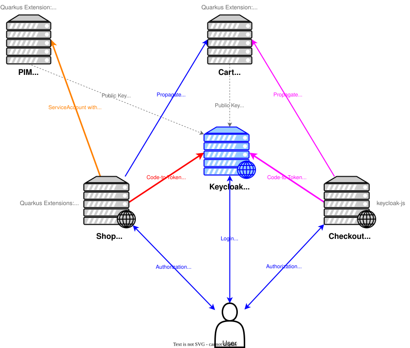

= Keycloak Bookshop Demo

Demo application landscape to show various and different kinds of user- and client authentication with Keycloak in a distributed environment with web applications and services.

== Description and Use Case

It's kind of a web shop, selling books.

Users can access the `shop` and the `checkout`, both are web apps.
They have to authenticate themselves using their credentials with Keycloak and web apps using the _Authorization Code Flow_ to get the users access token via code-to-token exchange from the Keycloak server (using backchannel in `shop` app).
The `shop` is a _Quarkus_ based application, using _Quarkus Extensions_, the `checkout` is a _React.JS_ based application, using the _keycloak-js JavaScript Adapter_.

The `shop` gets its products from the `pim` (product information management) service, also a Quarkus based service, dealing with BearerOnly token validation.

The `cart` service (Spring Boot based) stores the products a user wants to "buy".
So, it has to be accessed in the context of the user, but users can't access it directly, that's why the web apps (both, `shop` _and_ `checkout`) have to _propagate_ the users access token to the `cart`.

== Architectural Overview

== Docker Image

There is a public Docker image available with this distributed bookshop example.
Simply pull the image from the repository:

  $ docker pull ghcr.io/dasniko/keycloak-bookshop-demo:0.0.12

The configuration of the apps and services in the Docker image is aligned with the link:./bookshop-realm.json[`bookshop-realm.json`] realm JSON export available here in the repository root.

The apps and services expect Keycloak to be available under hostname/port `http://keycloak:8080`.

== GitHub Codespaces (HTTP-only)

In a GitHub Codespace, the Codespaces proxy terminates TLS and exposes every port under its own URL (`https://<codespace>-<port>.app.github.dev`).
For this, the apps and services can run HTTP-only: setting `HTTP_ONLY=true` in the Docker container switches all of them to plain HTTP and makes the browser-facing URLs configurable (`AUTH_SERVER_PUBLIC_URL`, `SHOP_PUBLIC_URL`, `CHECKOUT_PUBLIC_URL`, `CART_PUBLIC_URL`).
Without it, everything keeps running on HTTPS as before.

The link:./.devcontainer/devcontainer.json[dev container] starts link:./docker-compose.codespaces.yml[`docker-compose.codespaces.yml`] via link:./.devcontainer/start.sh[`start.sh`].
The script also sets the Keycloak clients `shop` and `checkout` to the Codespaces URLs and generates a random Keycloak admin password, stored in `.devcontainer/.kc-admin-password`.

The browser calls Keycloak and the `cart` service cross-origin, so both ports have to be public:

  $ gh codespace ports visibility 8080:public 8083:public -c "$CODESPACE_NAME"
